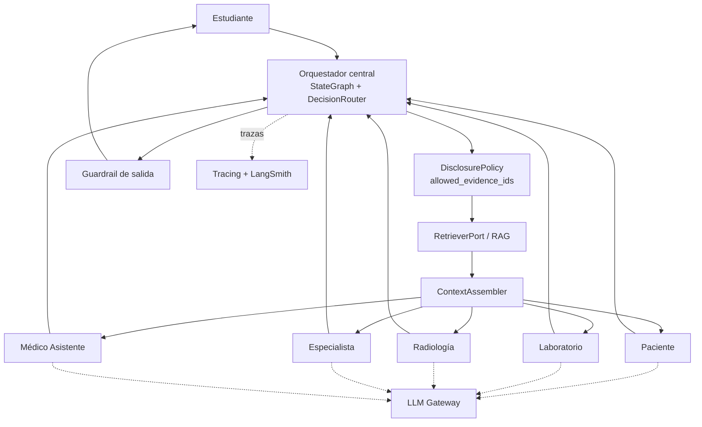

# Arquitectura consolidada del Sistema Multiagente

## Decisión actual

- **Topología SMA:** estrella.
- **Nodo central:** `backend/server/orchestration/`.
- **Control de estado:** LangGraph `StateGraph` + `backend/server/engine/state_machine/`.
- **Routing:** `DecisionRouter` determinístico.
- **Agentes hoja:** Médico Asistente, Paciente, Laboratorio, Radiología y Especialista.
- **Autorización:** `backend/server/engine/disclosure/` aplica `reveal_policy` y produce `allowed_evidence_ids`.
- **Aislamiento:** `backend/server/ai/` nunca importa `cases/` ni `engine/` y nunca recibe `protected`.
- **LLM:** `LLMGateway` con pool/fallback de credenciales o proveedores autorizados.
- **Observabilidad:** `backend/server/tracing/` con JSONL local y LangSmith opcional.
- **RAG:** `backend/server/rag/`; recupera dentro de la evidencia ya autorizada y no toma decisiones de acceso.
- **Base de datos:** la implementación persistente puede sustituir los adaptadores sin modificar los agentes.

## Regla central

La IA redacta. El código determinístico decide routing, fase, autorización, seguridad y trazabilidad.
`protected` no entra al contexto de ningún agente ni del LLM.
